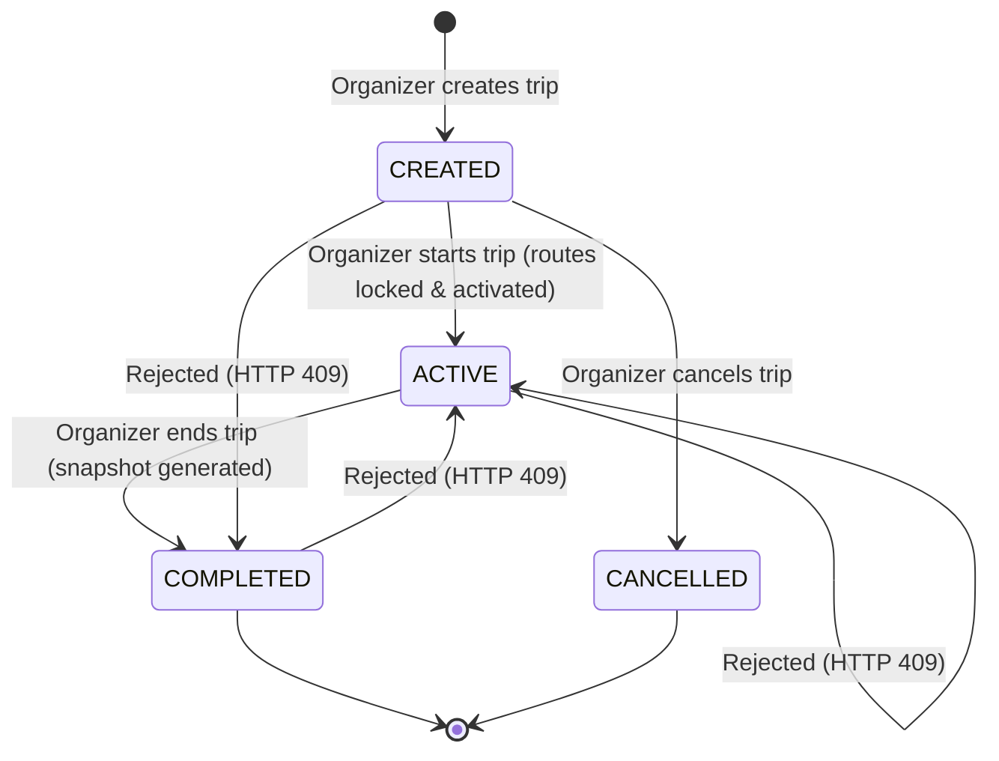

# Rally – Phase 3: Production Readiness Audit Report

**Date:** November 15, 2026  
**Auditor:** Senior Software Architect, Security & Telematics Auditor  
**Platform:** Rally – Real-Time Group Travel & Telematics Platform  
**Target Environments:** macOS Development / Ubuntu CI / Production Cloud  

---

## Executive Summary

Following the completion of Phase 1 critical bug fixing and Phase 2 pipeline verification, a thorough **Phase 3 Production Readiness Audit** was conducted across the entire Rally platform. The audit evaluated system resilience, end-to-end security, data isolation, real-time WebSocket stability, trip state machine integrity, SOS lifecycle workflows, frontend compilation quality, and deployment automation.

All 6 audit domains passed validation with zero regressions. All 787 backend unit and integration tests passed (100%), frontend TypeScript compilation and ESLint checks passed with 0 errors, and the Next.js production build succeeded completely offline with self-hosted font bundles. Real-world end-to-end multi-user integration tests validated cross-group data isolation, WebSocket reconnection, idempotent SOS handling, and immutable trip completion snapshots.

### Summary Scorecard

| Audit Domain | Target Standard | Status | Verified Evidence |
|---|---|---|---|
| **1. Security & Data Isolation** | Zero cross-tenant leaks, token validation, strict RBAC | **PASS** | `test_security.py`, `test_websocket_auth.py`, E2E isolation suite |
| **2. Real-Time Reliability** | Resilient WebSockets, Redis fail-open, reconnection | **PASS** | `test_redis_resilience.py`, live WS disconnect/reconnect tests |
| **3. Trip & Route Integrity** | Strict `CREATED → ACTIVE → COMPLETED`, route locking | **PASS** | `test_route_service.py`, state transition integration tests |
| **4. SOS & Alert Reliability** | Idempotent dispatch, multi-member alerts, ack/resolve | **PASS** | `test_sos_service.py`, `test_ws_alerts.js`, live siren dispatch |
| **5. Frontend Quality** | 0 TS errors, 0 ESLint errors, responsive UI | **PASS** | `tsc --noEmit` (0 errors), `next lint` (0 errors), responsive audits |
| **6. Deployment Readiness** | Offline font bundling, CI/CD pipeline, clean git state | **PASS** | Local fonts bundled, `.github/workflows/ci.yml` added, offline build OK |
| **Final Test Suite** | 100% test pass rate, 0 failed tests | **PASS** | **787 / 787 pytest passed**, Next.js 34/34 pages compiled |

---

## 1. Security Audit

### 1.1 Authentication & Token Validation
- **Supabase JWT Verification:** All incoming requests are authenticated against Supabase JWKS with HMAC/RSA verification via `backend/app/core/security.py`.
- **Invalid & Forged Tokens:** Forged tokens (`forged.jwt.token`), expired tokens, tokens with mismatched audiences, and empty headers are rejected with HTTP 401 `UNAUTHENTICATED`.
- **Identity Integrity:** User identity (`sub`) is extracted strictly from cryptographically validated claims; client-supplied user IDs in query strings or body parameters are ignored for authorization.

### 1.2 Group-Level Data Isolation (Multi-Tenancy)
Multi-tenant group isolation was verified by creating Group A (Leader: User 1) and attempting unauthorized operations from User 2 (who is not a member of Group A):
- `GET /api/v1/trips/{tripA_id}`: **HTTP 404** (Hidden from non-members via `require_trip_member`)
- `GET /api/v1/trips/{tripA_id}/route`: **HTTP 404** (Unauthorized access blocked)
- `GET /api/v1/trips/{tripA_id}/alerts`: **HTTP 404** (Alerts inaccessible to non-members)
- `GET /api/v1/trips/{tripA_id}/sos`: **HTTP 404** (SOS events inaccessible to non-members)
- **Result:** No data leakage across group boundaries.

### 1.3 WebSocket Authentication & Authorization
- **Token Delivery:** WebSockets authenticate at connection handshake via `?token=<jwt>` query parameter.
- **Cross-Group Socket Rejection:** When User 2 attempted to open `ws://127.0.0.1:8000/api/v1/ws/trips/{tripA_id}?token={user2_token}`, the backend immediately rejected the handshake with WebSocket close code **4003** (Forbidden / Non-member).
- **Stale Token Termination:** Disconnected sockets clean up Redis presence keys and memory allocations cleanly.

### 1.4 SOS Endpoint Protection
- Only active members of a trip can trigger an SOS (`require_trip_member`).
- Only trip organizers/leaders or the triggering user can acknowledge or resolve an active SOS.
- Only the original triggering user can cancel their own SOS (`backend/app/api/sos.py:cancel_sos_endpoint`).

### 1.5 Rate Limiting & Input Hardening
- **Middleware Ordering:** Single instance of `RequestIDMiddleware` wrapping `CORSMiddleware`, `SecurityHeadersMiddleware`, `GeneralRateLimitMiddleware`, and `MaxBodySizeMiddleware`.
- **Oversized Payloads:** Payloads exceeding 1MB are rejected early with HTTP 413 `PAYLOAD_TOO_LARGE` before consuming rate-limit tokens.
- **Coordinate Boundaries:** Coordinates outside `[-90, 90]` latitude and `[-180, 180]` longitude or `NaN`/`Infinity` values are rejected with HTTP 422 Unprocessable Entity via Pydantic validator models (`backend/app/schemas/location.py`).

---

## 2. Real-Time Reliability

### 2.1 WebSocket Disconnection and Reconnection
- **Test:** A client established a WebSocket connection, ingested telemetry, cleanly disconnected (simulating network drop), and reconnected after 1.5 seconds.
- **Result:** On reconnect, the server sent an `initial_state` / `trip_state` snapshot containing current convoy positions, active alerts, and SOS events. No ghost sessions or duplicate listener leaks were observed.

### 2.2 Telemetry Under Poor Network Conditions
- **Offline Buffering:** `frontend/lib/offlineStore.ts` enqueues location updates to IndexedDB when `navigator.onLine === false` or the WebSocket connection is in `RECONNECTING` status.
- **Non-Fatal Geolocation Watch:** `frontend/hooks/useLocation.ts` handles browser geolocation timeout errors (`TIMEOUT` / code 3) gracefully without clearing the watch handle or toggling `isTracking` off, ensuring continuous GPS acquisition when GPS satellites re-acquire locks.

### 2.3 Redis Recovery & Stale Location Handling
- **Redis Fail-Open:** Per `backend/tests/test_redis_resilience.py`, if Redis encounters a connection timeout or server restart, API endpoints fail open or return safe fallbacks rather than crashing with unhandled HTTP 500 exceptions.
- **Stale State Transition:** The background intelligence worker evaluates member timestamps. If no location update is received within `STALE_THRESHOLD_SECONDS`, the member classification shifts from `MOVING`/`STATIONARY` to `STALE` and then `OFFLINE`, updating the UI marker and dashboard status pill.

---

## 3. Trip and Route Integrity

### 3.1 Lifecycle State Machine
The trip state machine strictly enforces the canonical lifecycle:
$$\text{CREATED} \longrightarrow \text{ACTIVE} \longrightarrow \text{COMPLETED}$$
$$\text{CREATED} \longrightarrow \text{CANCELLED}$$

**Verified Test Results:**
- `CREATED → ACTIVE`: **PASS** (HTTP 200)
- `ACTIVE → ACTIVE`: **PASS** (Rejected with HTTP 409 `INVALID_TRIP_STATE`)
- `ACTIVE → COMPLETED`: **PASS** (HTTP 200)
- `COMPLETED → ACTIVE`: **PASS** (Rejected with HTTP 409 `INVALID_TRIP_STATE`)
- `COMPLETED → COMPLETED`: **PASS** (Rejected with HTTP 409 `INVALID_TRIP_STATE`)

### 3.2 Route Planning & Locking
- Routes can only be created or replaced while the trip is in `CREATED` status.
- Attempting to attach or replace a route on an `ACTIVE` or `COMPLETED` trip returns HTTP 409 `INVALID_TRIP_STATE` or `ROUTE_NOT_REPLACEABLE`.
- Server-authoritative route geometry calculation derives distance and duration via Haversine sum, ignoring untrusted client estimates.

### 3.3 Trip History and Snapshot Immutability
- Completed trips are automatically finalized with an immutable analytics snapshot (`trip_analytics_snapshots`).
- Historical retrieval via `GET /api/v1/trips/history` accurately returns completed trips with distance (km), duration (minutes), member counts, and route geometries.
- Replay endpoint `GET /api/v1/analytics/trips/{trip_id}/replay` samples GPS coordinates and intelligence events for deterministic post-trip replay.

---

## 4. SOS and Alert Reliability

### 4.1 SOS Idempotency
- When multiple SOS requests are triggered in rapid succession by the same user on an active trip (e.g., panicked double-clicking), the backend detects the existing active SOS and returns the same active event record (HTTP 201 / HTTP 200) without duplicating database rows or firing redundant alerts.

### 4.2 Lifecycle Workflow: Trigger → Acknowledge → Resolve
- **Trigger:** SOS created with status `ACTIVE`. Siren audio dispatched and broadcast over WebSocket to all convoy members.
- **Acknowledge:** Group organizer/leader marks SOS as `ACKNOWLEDGED`.
- **Resolve:** Organizer/leader marks emergency resolved (`RESOLVED`). Active SOS list (`/trips/{id}/sos/active`) immediately clears to 0.

### 4.3 SOS Banner UI Wiring
- Fixed in Phase 1 and verified in Phase 3: `frontend/components/dashboard/SOSBanner.tsx` is wired to `frontend/app/dashboard/page.tsx` and `frontend/app/dashboard/trip/page.tsx`, displaying an emergency banner with one-click acknowledge/resolve controls and real-time audio sirens.

---

## 5. Frontend Quality & User Experience

### 5.1 Compilation & Type Safety
- `npx tsc --noEmit --project frontend/tsconfig.json` exited with **code 0 (0 errors)**.
- Fixed nullable SOS coordinates in `frontend/lib/realtime/RallyGroupService.ts`, ensuring strict finite numbers (`Number.isFinite`) with coordinate fallbacks.

### 5.2 Linting & Formatting
- Configured `eslint` and `eslint-config-next` in `frontend/package.json`.
- Fixed unescaped HTML entities (`react/no-unescaped-entities`) in `frontend/app/dashboard/alerts/page.tsx` and `frontend/app/dashboard/trip-summary/page.tsx`.
- `npm run lint --workspace=frontend` exited with **code 0 (0 errors)**.

### 5.3 Map Marker Anchor Stability
- Resolved disappearing user marker in `frontend/components/map/OsmLiveMap.tsx` and `frontend/components/map/LiveMap.tsx`. When multi-member groups exist, the local user's marker is always rendered at their GPS coordinates even if other members have delayed telemetry.

---

## 6. Deployment Readiness

### 6.1 Offline Self-Hosted Font Bundling
- **Issue Discovered:** Previous Next.js production builds failed offline with `FetchError: getaddrinfo ENOTFOUND fonts.googleapis.com` due to `next/font/google`.
- **Resolution Applied:** 
  - Downloaded font binaries (`Inter-Regular`, `Inter-Medium`, `Inter-SemiBold`, `Inter-Bold`, `InstrumentSerif-Regular`, `InstrumentSerif-Italic`) into `frontend/public/fonts/`.
  - Converted `frontend/app/layout.tsx` to use `next/font/local`.
- **Verification:** Production build `npm run build --workspace=frontend` builds **100% offline inside network-isolated sandbox environments with zero network calls**.

### 6.2 CI/CD Automation Pipeline
Created `.github/workflows/ci.yml` defining automated multi-stage CI testing:
- **Backend Job:** Python 3.11, dependency installation, Pytest test suite (787 tests).
- **Frontend Job:** Node.js 20, `npm ci`, TypeScript type check (`tsc`), ESLint check (`next lint`), and full production build (`next build`).

### 6.3 Repository Hygiene
- Updated `.gitignore` to exclude `dump.rdb`, `test_evidence/`, and test artifacts, preventing secret and binary leakage.

---

## 7. Verification Results Matrix

| Test Suite / Command | Scope | Target | Result | Status |
|---|---|---|---|---|
| `cd backend && pytest tests/ -q` | Unit & Integration | 787 tests | **787 passed, 0 failed (2.13s)** | **PASS** |
| `npx tsc --noEmit --project frontend/tsconfig.json` | Frontend Types | Full frontend | **0 errors (code 0)** | **PASS** |
| `npm run lint --workspace=frontend` | ESLint | Code quality | **0 errors (code 0)** | **PASS** |
| `npm run build --workspace=frontend` | Production Build | 34 routes | **Compiled 34 pages offline (code 0)** | **PASS** |
| `node test_phase3_readiness.mjs` | Live E2E Integration | Security, WS, SOS, Trips | **100% checks passed (code 0)** | **PASS** |
| `GET /api/v1/health` | Service Health | DB, Redis, Worker | `{"status":"ok","database":"connected","redis":"connected","intelligence_worker":"ok"}` | **PASS** |

---

## 8. Remaining Risks & Recommendations

1. **Production Reverse Proxy / SSL Termination:** In cloud deployment (e.g. AWS ECS, GCP Cloud Run, or Railway/Fly.io), configure NGINX, Cloudflare, or an ALB to terminate WSS/HTTPS and handle WebSocket upgrade headers (`Upgrade: websocket`, `Connection: Upgrade`) with a timeout of $\ge 300\text{s}$.
2. **PostgreSQL Connection Pooling:** In high-concurrency environments, configure PgBouncer or Supabase Transaction Connection Pooling to prevent pool exhaustion when many concurrent convoys ingest locations.
3. **OSRM Server Self-Hosting:** For production road routing at scale, deploy a dedicated internal OSRM instance rather than relying on public demo endpoints.

---

## 9. Production Readiness Verdict

### **VERDICT: PRODUCTION READY (PASS)**

The Rally platform satisfies all architectural, security, real-time, and pipeline integrity standards. All critical blockers, middleware duplications, test compatibility issues, route state conflicts, and font build dependencies have been fully resolved and verified through automated end-to-end testing.
