# RALLY — Database & Data Schema Specification

This document provides a comprehensive reference for the data architecture and database schema of **RALLY**, a real-time group mobility and safety platform.

---

## Table of Contents

1. [Architectural Overview](#architectural-overview)
2. [Storage Tiers & Responsibilities](#storage-tiers--responsibilities)
3. [Entity-Relationship Diagram (ERD)](#entity-relationship-diagram-erd)
4. [Relational Data Dictionary](#relational-data-dictionary)
   - [auth.users (Supabase Identity)](#1-authusers-external-supabase-auth)
   - [profiles](#2-profiles-application-user-profiles)
   - [groups](#3-groups-rally-groups)
   - [group_members](#4-group_members-membership-and-roles)
   - [trips](#5-trips-journey-lifecycle)
   - [location_history](#6-location_history-gps-breadcrumb-log)
   - [intelligence_events](#7-intelligence_events-raw-safety-detections)
   - [alerts](#8-alerts-user-facing-safety-alerts)
   - [sos_events](#9-sos_events-user-triggered-emergencies)
   - [routes](#10-routes-planned-trip-paths)
   - [trip_analytics_snapshots](#11-trip_analytics_snapshots-post-trip-metrics)
   - [notifications](#12-notifications-in-app-user-notifications)
5. [Enumerations Reference](#enumerations-reference)
6. [Geospatial Architecture (PostGIS)](#geospatial-architecture-postgis)
7. [Integrity, Concurrency & Partial Indexes](#integrity-concurrency--partial-indexes)
8. [Real-Time Ephemeral Schema (Redis)](#real-time-ephemeral-schema-redis)
9. [Alembic Migrations Ledger](#alembic-migrations-ledger)
10. [Client & API Schema Mapping](#client--api-schema-mapping)

---

## Architectural Overview

RALLY utilizes a dual-tier storage strategy optimized for high-throughput mobile telemetry, spatial querying, and immutable audit logs:

```
┌────────────────────────────────────────────────────────────────────────┐
│                          Mobile & Web Clients                          │
└───────────────────▲────────────────────────────────┬───────────────────┘
                    │ WebSocket                      │ HTTPS (REST)
                    │ (Live telemetry / Broadcast)   │ (Auth, Trips, Groups)
┌───────────────────▼───────────────────┐ ┌──────────▼───────────────────┐
│              Redis Tier               │ │           FastAPI Tier        │
│  - Ephemeral Member State             │ │  - Supabase JWT Verification  │
│  - Online / Degraded / Offline Flags  │ │  - SQLAlchemy 2.0 ORM Engine  │
│  - Pub/Sub Group Broadcasting         │ │  - Intelligence & Risk Engine │
│  - Distributed Concurrency Locks      │ │  - Route Matching (Shapely)   │
└───────────────────────────────────────┘ └──────────┬───────────────────┘
                                                     │
                                          SQL Queries│ (psycopg v3)
                                                     ▼
┌────────────────────────────────────────────────────────────────────────┐
│                 PostgreSQL 15+ with PostGIS Extension                  │
│                                                                        │
│  [auth.users] (Supabase Auth External Store)                           │
│        │                                                               │
│        ▼ (1:1)                                                         │
│   [profiles] ───────┬────────────┬─────────────┬───────────┐           │
│        │            │            │             │           │           │
│        ▼ (1:N)      ▼ (1:N)      ▼ (1:N)       ▼ (1:N)     ▼ (1:N)     │
│     [groups] ───► [group_    [location_     [alerts]     [notifi-      │
│        │          members]    history]                   cations]      │
│        ▼ (1:N)                   ▲                                     │
│     [trips] ─────────────────────┤                                     │
│        │                         │                                     │
│        ├────────────► [intelligence_events] ───► [alerts]              │
│        ├────────────► [sos_events]                                     │
│        ├────────────► [routes] (1:1)                                   │
│        └────────────► [trip_analytics_snapshots] (1:1)                 │
└────────────────────────────────────────────────────────────────────────┘
```

---

## Storage Tiers & Responsibilities

| Layer | Technology | Primary Role | Data Lifetime |
|---|---|---|---|
| **Identity** | Supabase Auth (`auth.users`) | User credential management, OAuth, JWT issuance. | Persistent |
| **Relational / Geospatial** | PostgreSQL 15+ & PostGIS 3+ | ACID transactions, historical GPS logs, audit logs, spatial calculations. | Permanent |
| **ORM / Migration** | SQLAlchemy 2.0 & Alembic | Schema definitions, type casting, migration versions. | Versioned Code |
| **In-Memory Cache** | Redis 7+ | Live device telemetry, member presence, heartbeat deduplication. | Ephemeral |
| **Application Layer** | Pydantic v2 | Input validation, API serialisation, HTTP DTOs. | Request Scope |
| **Client Types** | TypeScript (`packages/types`) | Shared frontend/backend interface contracts. | Compile Time |

---

## Entity-Relationship Diagram (ERD)

```mermaid
erDiagram

    AUTH_USERS {
        UUID id PK "Supabase Auth UID"
    }

    PROFILES {
        UUID id PK,FK "auth.users.id (CASCADE)"
        VARCHAR full_name
        TEXT avatar_url
        TIMESTAMPTZ created_at
        TIMESTAMPTZ updated_at
    }

    GROUPS {
        UUID id PK
        VARCHAR name
        VARCHAR join_code "UNIQUE, Index"
        UUID leader_id FK "profiles.id (SET NULL)"
        VARCHAR destination_name
        GEOGRAPHY destination "POINT, 4326"
        ENUM status "ACTIVE | COMPLETED | ARCHIVED"
        TIMESTAMPTZ created_at
        TIMESTAMPTZ updated_at
    }

    GROUP_MEMBERS {
        UUID id PK
        UUID group_id FK "groups.id (CASCADE)"
        UUID user_id FK "profiles.id (CASCADE)"
        ENUM role "LEADER | MEMBER"
        ENUM status "ACTIVE | LEFT | REMOVED"
        TIMESTAMPTZ joined_at
    }

    TRIPS {
        UUID id PK
        UUID group_id FK "groups.id (RESTRICT)"
        UUID started_by FK "profiles.id (SET NULL)"
        ENUM status "CREATED | ACTIVE | COMPLETED | CANCELLED"
        TIMESTAMPTZ started_at
        TIMESTAMPTZ ended_at
        VARCHAR destination_name
        GEOGRAPHY start_location "POINT, 4326"
        GEOGRAPHY destination "POINT, 4326"
        FLOAT distance "km"
        INTEGER duration "minutes"
        INTEGER safety_score "0-100"
        TIMESTAMPTZ created_at
        TIMESTAMPTZ updated_at
    }

    LOCATION_HISTORY {
        UUID id PK
        UUID trip_id FK "trips.id (CASCADE)"
        UUID group_id FK "groups.id (CASCADE)"
        UUID user_id FK "profiles.id (CASCADE)"
        GEOGRAPHY location "POINT, 4326"
        FLOAT latitude
        FLOAT longitude
        FLOAT accuracy
        FLOAT speed "m/s"
        FLOAT heading "0-360 deg"
        TIMESTAMPTZ recorded_at "Indexed"
        TIMESTAMPTZ created_at
    }

    INTELLIGENCE_EVENTS {
        UUID id PK
        UUID group_id FK "groups.id (CASCADE)"
        UUID trip_id FK "trips.id (CASCADE)"
        UUID user_id FK "profiles.id (SET NULL)"
        UUID related_user_id FK "profiles.id (SET NULL)"
        ENUM event_type "FALLING_BEHIND | GROUP_SEPARATION | ..."
        ENUM severity "INFO | WARNING | CRITICAL"
        FLOAT latitude
        FLOAT longitude
        GEOGRAPHY location "POINT, 4326"
        JSONB event_metadata
        TIMESTAMPTZ detected_at
        TIMESTAMPTZ resolved_at "NULL = active"
        TIMESTAMPTZ created_at
    }

    ALERTS {
        UUID id PK
        UUID group_id FK "groups.id (CASCADE)"
        UUID trip_id FK "trips.id (CASCADE)"
        UUID event_id FK "intelligence_events.id (SET NULL)"
        UUID user_id FK "profiles.id (SET NULL)"
        UUID related_user_id FK "profiles.id (SET NULL)"
        ENUM alert_type "FALLING_BEHIND | GROUP_SEPARATION | ..."
        ENUM severity "INFO | WARNING | CRITICAL"
        ENUM status "ACTIVE | ACKNOWLEDGED | RESOLVED"
        TEXT title
        TEXT message
        GEOGRAPHY location "POINT, 4326"
        JSONB alert_metadata
        TIMESTAMPTZ created_at
        TIMESTAMPTZ acknowledged_at
        TIMESTAMPTZ resolved_at "NULL = unresolved"
    }

    SOS_EVENTS {
        UUID id PK
        UUID group_id FK "groups.id (CASCADE)"
        UUID trip_id FK "trips.id (CASCADE)"
        UUID user_id FK "profiles.id (SET NULL)"
        FLOAT latitude
        FLOAT longitude
        FLOAT accuracy
        GEOGRAPHY location "POINT, 4326"
        ENUM status "ACTIVE | ACKNOWLEDGED | RESOLVED | CANCELLED"
        TEXT message
        JSONB sos_metadata
        TIMESTAMPTZ triggered_at
        TIMESTAMPTZ acknowledged_at
        TIMESTAMPTZ resolved_at
        TIMESTAMPTZ created_at
    }

    ROUTES {
        UUID id PK
        UUID trip_id FK "trips.id (CASCADE), UNIQUE"
        VARCHAR name
        FLOAT origin_latitude
        FLOAT origin_longitude
        FLOAT destination_latitude
        FLOAT destination_longitude
        GEOMETRY geometry "LINESTRING, 4326"
        JSONB coordinates "[[lng,lat], ...]"
        FLOAT distance_meters
        INTEGER estimated_duration_seconds
        ENUM status "PLANNED | ACTIVE | COMPLETED | CANCELLED"
        TIMESTAMPTZ created_at
        TIMESTAMPTZ updated_at
    }

    TRIP_ANALYTICS_SNAPSHOTS {
        UUID id PK
        UUID trip_id FK "trips.id (CASCADE), UNIQUE"
        INTEGER duration_seconds
        FLOAT distance_traveled_meters
        FLOAT planned_distance_meters
        FLOAT completion_percent
        INTEGER member_count
        INTEGER alerts_count
        INTEGER critical_alerts_count
        INTEGER sos_count
        INTEGER route_deviations
        TIMESTAMPTZ generated_at
    }

    NOTIFICATIONS {
        UUID id PK
        UUID user_id FK "profiles.id (CASCADE)"
        UUID trip_id FK "trips.id (CASCADE)"
        VARCHAR type
        TEXT title
        TEXT message
        VARCHAR severity "INFO | WARNING | CRITICAL"
        VARCHAR dedup_key "Nullable, Partial UNIQUE"
        JSONB notification_metadata
        TIMESTAMPTZ read_at
        TIMESTAMPTZ created_at
    }

    AUTH_USERS ||--|| PROFILES : "1:1 Identity"
    PROFILES ||--o{ GROUPS : "leads"
    PROFILES ||--o{ GROUP_MEMBERS : "membership"
    PROFILES ||--o{ TRIPS : "initiates"
    PROFILES ||--o{ LOCATION_HISTORY : "reports"
    PROFILES ||--o{ INTELLIGENCE_EVENTS : "subject of"
    PROFILES ||--o{ ALERTS : "subject of"
    PROFILES ||--o{ SOS_EVENTS : "triggers"
    PROFILES ||--o{ NOTIFICATIONS : "receives"

    GROUPS ||--o{ GROUP_MEMBERS : "has"
    GROUPS ||--o{ TRIPS : "conducts"
    GROUPS ||--o{ LOCATION_HISTORY : "contains"
    GROUPS ||--o{ INTELLIGENCE_EVENTS : "records"
    GROUPS ||--o{ ALERTS : "broadcasts"
    GROUPS ||--o{ SOS_EVENTS : "contains"

    TRIPS ||--o{ LOCATION_HISTORY : "tracks"
    TRIPS ||--o{ INTELLIGENCE_EVENTS : "evaluates"
    TRIPS ||--o{ ALERTS : "generates"
    TRIPS ||--o{ SOS_EVENTS : "logs"
    TRIPS ||--o| ROUTES : "follows (0..1)"
    TRIPS ||--o| TRIP_ANALYTICS_SNAPSHOTS : "freezes into (0..1)"
    TRIPS ||--o{ NOTIFICATIONS : "references"

    INTELLIGENCE_EVENTS ||--o| ALERTS : "escalates to (0..1)"
```



---

## Relational Data Dictionary

### 1. `auth.users` (External Supabase Auth)
Managed entirely by Supabase. RALLY backend models a shadow table ([auth_shadow.py](file:///Users/pranavsonare/Downloads/Rally-major/backend/app/models/auth_shadow.py)) strictly to satisfy foreign key referential integrity during tests and ORM reflection.

| Column | Type | Constraints | Description |
|---|---|---|---|
| `id` | `UUID` | `PRIMARY KEY` | Supabase auth user identifier. |

---

### 2. `profiles` (Application User Profiles)
- **Model**: [Profile](file:///Users/pranavsonare/Downloads/Rally-major/backend/app/models/profile.py)
- **Migration**: [0001_initial_schema.py](file:///Users/pranavsonare/Downloads/Rally-major/backend/alembic/versions/0001_initial_schema.py)
- **Description**: Stores user profile details linked 1-to-1 with Supabase Auth. Created automatically upon first authenticated request to `/api/v1/auth/me`.

| Column | Type | Nullable | Default | Constraints & Relationships |
|---|---|---|---|---|
| `id` | `UUID` | No | None | `PRIMARY KEY`, `FK -> auth.users.id ON DELETE CASCADE` |
| `full_name` | `VARCHAR(150)` | Yes | `NULL` | User display name. |
| `avatar_url` | `TEXT` | Yes | `NULL` | Public avatar image URI. |
| `created_at` | `TIMESTAMPTZ` | No | `NOW()` (UTC) | Record creation timestamp. |
| `updated_at` | `TIMESTAMPTZ` | No | `NOW()` (UTC) | Automatically updated on change. |

---

### 3. `groups` (Rally Groups)
- **Model**: [Group](file:///Users/pranavsonare/Downloads/Rally-major/backend/app/models/group.py)
- **Migration**: [0001_initial_schema.py](file:///Users/pranavsonare/Downloads/Rally-major/backend/alembic/versions/0001_initial_schema.py)
- **Description**: Represents a persistent group of riders/drivers traveling together.

| Column | Type | Nullable | Default | Constraints & Relationships |
|---|---|---|---|---|
| `id` | `UUID` | No | `uuid4()` | `PRIMARY KEY` |
| `name` | `VARCHAR(150)` | No | None | Human-readable group name. |
| `join_code` | `VARCHAR(20)` | No | None | `UNIQUE`, `INDEX`. Short invite code for joining. |
| `leader_id` | `UUID` | Yes | `NULL` | `FK -> profiles.id ON DELETE SET NULL`. Current group admin. |
| `destination_name` | `VARCHAR(255)` | Yes | `NULL` | Human-friendly destination label. |
| `destination` | `GEOGRAPHY(POINT, 4326)` | Yes | `NULL` | Destination coordinates for geospatial queries. |
| `status` | `group_status` (Enum) | No | `'ACTIVE'` | `'ACTIVE'`, `'COMPLETED'`, or `'ARCHIVED'`. |
| `created_at` | `TIMESTAMPTZ` | No | `NOW()` (UTC) | Creation timestamp. |
| `updated_at` | `TIMESTAMPTZ` | No | `NOW()` (UTC) | Last modification timestamp. |

> [!NOTE]
> `leader_id` uses `ON DELETE SET NULL`: if a leader deletes their user account, the group persists, allowing members to transfer leadership.

---

### 4. `group_members` (Membership and Roles)
- **Model**: [GroupMember](file:///Users/pranavsonare/Downloads/Rally-major/backend/app/models/group_member.py)
- **Migration**: [0001_initial_schema.py](file:///Users/pranavsonare/Downloads/Rally-major/backend/alembic/versions/0001_initial_schema.py)
- **Description**: Junction table managing users inside groups, their roles, and departure status.

| Column | Type | Nullable | Default | Constraints & Relationships |
|---|---|---|---|---|
| `id` | `UUID` | No | `uuid4()` | `PRIMARY KEY` |
| `group_id` | `UUID` | No | None | `INDEX`, `FK -> groups.id ON DELETE CASCADE` |
| `user_id` | `UUID` | No | None | `INDEX`, `FK -> profiles.id ON DELETE CASCADE` |
| `role` | `member_role` (Enum) | No | `'MEMBER'` | `'LEADER'` or `'MEMBER'`. |
| `status` | `member_status` (Enum) | No | `'ACTIVE'` | `'ACTIVE'`, `'LEFT'`, or `'REMOVED'`. |
| `joined_at` | `TIMESTAMPTZ` | No | `NOW()` (UTC) | Timestamp when member joined. |

**Indexes & Constraints**:
- `uq_group_members_group_user`: `UNIQUE(group_id, user_id)` ensures a user cannot be added twice to the same group.

---

### 5. `trips` (Journey Lifecycle)
- **Model**: [Trip](file:///Users/pranavsonare/Downloads/Rally-major/backend/app/models/trip.py)
- **Migrations**: [0001_initial_schema.py](file:///Users/pranavsonare/Downloads/Rally-major/backend/alembic/versions/0001_initial_schema.py), [0002_trip_lifecycle.py](file:///Users/pranavsonare/Downloads/Rally-major/backend/alembic/versions/0002_trip_lifecycle.py), [0006_trip_analytics_snapshots.py](file:///Users/pranavsonare/Downloads/Rally-major/backend/alembic/versions/0006_trip_analytics_snapshots.py)
- **Description**: A specific voyage conducted by a group. Follows a finite state machine: `CREATED -> ACTIVE -> COMPLETED` or `CREATED -> CANCELLED`.

| Column | Type | Nullable | Default | Constraints & Relationships |
|---|---|---|---|---|
| `id` | `UUID` | No | `uuid4()` | `PRIMARY KEY` |
| `group_id` | `UUID` | No | None | `INDEX`, `FK -> groups.id ON DELETE RESTRICT` |
| `started_by` | `UUID` | Yes | `NULL` | `INDEX`, `FK -> profiles.id ON DELETE SET NULL` |
| `status` | `trip_status` (Enum) | No | `'CREATED'` | `INDEX`. `'CREATED'`, `'ACTIVE'`, `'COMPLETED'`, `'CANCELLED'`. |
| `started_at` | `TIMESTAMPTZ` | Yes | `NULL` | Actual journey departure timestamp. |
| `ended_at` | `TIMESTAMPTZ` | Yes | `NULL` | Journey completion or cancellation timestamp. |
| `destination_name` | `VARCHAR(255)` | Yes | `NULL` | Destination name for the trip. |
| `start_location` | `GEOGRAPHY(POINT, 4326)` | Yes | `NULL` | Origin GPS point. |
| `destination` | `GEOGRAPHY(POINT, 4326)` | Yes | `NULL` | Target destination GPS point. |
| `distance` | `FLOAT` | Yes | `NULL` | Total distance in kilometers. |
| `duration` | `INTEGER` | Yes | `NULL` | Duration in minutes. |
| `safety_score` | `INTEGER` | Yes | `NULL` | Computed trip safety index (0 to 100). |
| `created_at` | `TIMESTAMPTZ` | No | `NOW()` (UTC) | Record creation timestamp. |
| `updated_at` | `TIMESTAMPTZ` | No | `NOW()` (UTC) | Record update timestamp. |

**Key Constraints & Indexes**:
- `uq_trips_one_active_per_group`: Partial Unique Index `UNIQUE(group_id) WHERE (status = 'ACTIVE')`. Prevents race conditions from starting concurrent active trips.
- `ix_trips_group_created`: Composite index `(group_id, created_at)` for sorting group trip history chronologically without table scans.
- `ON DELETE RESTRICT` on `group_id`: Prevents deleting a group if historical trips exist.

---

### 6. `location_history` (GPS Breadcrumb Log)
- **Model**: [LocationHistory](file:///Users/pranavsonare/Downloads/Rally-major/backend/app/models/location_history.py)
- **Migration**: [0001_initial_schema.py](file:///Users/pranavsonare/Downloads/Rally-major/backend/alembic/versions/0001_initial_schema.py)
- **Description**: Append-only log of GPS telemetry emitted by client devices during active trips.

| Column | Type | Nullable | Default | Constraints & Relationships |
|---|---|---|---|---|
| `id` | `UUID` | No | `uuid4()` | `PRIMARY KEY` |
| `trip_id` | `UUID` | No | None | `INDEX`, `FK -> trips.id ON DELETE CASCADE` |
| `group_id` | `UUID` | No | None | `INDEX`, `FK -> groups.id ON DELETE CASCADE` |
| `user_id` | `UUID` | No | None | `INDEX`, `FK -> profiles.id ON DELETE CASCADE` |
| `location` | `GEOGRAPHY(POINT, 4326)` | No | None | PostGIS spatial point `(lng, lat)` for spatial queries. |
| `latitude` | `FLOAT` | No | None | WGS 84 latitude (-90 to +90). |
| `longitude` | `FLOAT` | No | None | WGS 84 longitude (-180 to +180). |
| `accuracy` | `FLOAT` | Yes | `NULL` | Horizontal accuracy in meters. |
| `speed` | `FLOAT` | Yes | `NULL` | Speed in meters/second. |
| `heading` | `FLOAT` | Yes | `NULL` | Bearing in degrees (0 to 359.9). |
| `recorded_at` | `TIMESTAMPTZ` | No | None | `INDEX`. Device-reported capture timestamp. |
| `created_at` | `TIMESTAMPTZ` | No | `NOW()` (UTC) | Server insertion timestamp. |

**Composite Indexes**:
- `ix_location_history_trip_recorded`: `(trip_id, recorded_at)`
- `ix_location_history_group_recorded`: `(group_id, recorded_at)`
- `ix_location_history_user_recorded`: `(user_id, recorded_at)`

> [!TIP]
> `group_id` is redundantly stored alongside `trip_id` to allow high-throughput group spatial filtering without joining the `trips` table.

---

### 7. `intelligence_events` (Raw Safety Detections)
- **Model**: [IntelligenceEvent](file:///Users/pranavsonare/Downloads/Rally-major/backend/app/models/intelligence_event.py)
- **Migrations**: [0003_intelligence_events.py](file:///Users/pranavsonare/Downloads/Rally-major/backend/alembic/versions/0003_intelligence_events.py), [0005_routes.py](file:///Users/pranavsonare/Downloads/Rally-major/backend/alembic/versions/0005_routes.py)
- **Description**: Stores raw algorithmic detections generated by background safety analyzers (e.g. falling behind, cluster dispersion, route deviations).

| Column | Type | Nullable | Default | Constraints & Relationships |
|---|---|---|---|---|
| `id` | `UUID` | No | `uuid4()` | `PRIMARY KEY` |
| `group_id` | `UUID` | No | None | `INDEX`, `FK -> groups.id ON DELETE CASCADE` |
| `trip_id` | `UUID` | No | None | `INDEX`, `FK -> trips.id ON DELETE CASCADE` |
| `event_type` | `intelligence_event_type` (Enum) | No | None | `INDEX`. Type of event detected. |
| `severity` | `intelligence_severity` (Enum) | No | None | `'INFO'`, `'WARNING'`, or `'CRITICAL'`. |
| `user_id` | `UUID` | Yes | `NULL` | `INDEX`, `FK -> profiles.id ON DELETE SET NULL`. Subject member. |
| `related_user_id` | `UUID` | Yes | `NULL` | `FK -> profiles.id ON DELETE SET NULL`. Relative member. |
| `latitude` | `FLOAT` | Yes | `NULL` | Detection latitude. |
| `longitude` | `FLOAT` | Yes | `NULL` | Detection longitude. |
| `location` | `GEOGRAPHY(POINT, 4326)` | Yes | `NULL` | Detection spatial geography point. |
| `event_metadata` | `JSONB` | No | `'{}'` | Event-specific telemetry payload (distances, thresholds). |
| `detected_at` | `TIMESTAMPTZ` | No | `NOW()` (UTC) | Timestamp when condition was first detected. |
| `resolved_at` | `TIMESTAMPTZ` | Yes | `NULL` | Resolution timestamp (`NULL` = currently active). |
| `created_at` | `TIMESTAMPTZ` | No | `NOW()` (UTC) | Row creation timestamp. |

**Indexes & Deduplication**:
- `uq_intelligence_events_one_active_per_subject`: `UNIQUE(trip_id, event_type, user_id) WHERE (resolved_at IS NULL)`. Prevents duplicate active detection rows while an anomaly is ongoing.

---

### 8. `alerts` (User-Facing Safety Alerts)
- **Model**: [Alert](file:///Users/pranavsonare/Downloads/Rally-major/backend/app/models/alert.py)
- **Migrations**: [0004_alerts_and_sos.py](file:///Users/pranavsonare/Downloads/Rally-major/backend/alembic/versions/0004_alerts_and_sos.py), [0005_routes.py](file:///Users/pranavsonare/Downloads/Rally-major/backend/alembic/versions/0005_routes.py)
- **Description**: Actionable, user-visible alerts decided by the alert policy engine from underlying `intelligence_events`.

| Column | Type | Nullable | Default | Constraints & Relationships |
|---|---|---|---|---|
| `id` | `UUID` | No | `uuid4()` | `PRIMARY KEY` |
| `group_id` | `UUID` | No | None | `INDEX`, `FK -> groups.id ON DELETE CASCADE` |
| `trip_id` | `UUID` | No | None | `INDEX`, `FK -> trips.id ON DELETE CASCADE` |
| `event_id` | `UUID` | Yes | `NULL` | `INDEX`, `FK -> intelligence_events.id ON DELETE SET NULL` |
| `alert_type` | `alert_type` (Enum) | No | None | `INDEX`. Alert classification. |
| `severity` | `alert_severity` (Enum) | No | None | `'INFO'`, `'WARNING'`, or `'CRITICAL'`. |
| `status` | `alert_status` (Enum) | No | `'ACTIVE'` | `INDEX`. `'ACTIVE'`, `'ACKNOWLEDGED'`, or `'RESOLVED'`. |
| `user_id` | `UUID` | Yes | `NULL` | `INDEX`, `FK -> profiles.id ON DELETE SET NULL` |
| `related_user_id` | `UUID` | Yes | `NULL` | `FK -> profiles.id ON DELETE SET NULL` |
| `title` | `TEXT` | No | None | Concise alert headline. |
| `message` | `TEXT` | No | None | Detailed notification message. |
| `location` | `GEOGRAPHY(POINT, 4326)` | Yes | `NULL` | Spatial location where alert surfaced. |
| `alert_metadata` | `JSONB` | No | `'{}'` | Snapshot of detection metrics. |
| `created_at` | `TIMESTAMPTZ` | No | `NOW()` (UTC) | Creation timestamp. |
| `acknowledged_at` | `TIMESTAMPTZ` | Yes | `NULL` | When a user acknowledged the alert. |
| `resolved_at` | `TIMESTAMPTZ` | Yes | `NULL` | When the alert condition cleared (`NULL` = unresolved). |

**Deduplication Constraint**:
- `uq_alerts_one_unresolved_per_event`: `UNIQUE(event_id) WHERE (resolved_at IS NULL)`. Ensures a single ongoing intelligence event cannot generate multiple unresolved alerts.

---

### 9. `sos_events` (User-Triggered Emergencies)
- **Model**: [SOSEvent](file:///Users/pranavsonare/Downloads/Rally-major/backend/app/models/sos_event.py)
- **Migrations**: [0001_initial_schema.py](file:///Users/pranavsonare/Downloads/Rally-major/backend/alembic/versions/0001_initial_schema.py), [0004_alerts_and_sos.py](file:///Users/pranavsonare/Downloads/Rally-major/backend/alembic/versions/0004_alerts_and_sos.py)
- **Description**: Explicit panic/emergency triggers initiated by members. Immutable coordinates capture the exact distress point.

| Column | Type | Nullable | Default | Constraints & Relationships |
|---|---|---|---|---|
| `id` | `UUID` | No | `uuid4()` | `PRIMARY KEY` |
| `group_id` | `UUID` | No | None | `INDEX`, `FK -> groups.id ON DELETE CASCADE` |
| `trip_id` | `UUID` | No | None | `INDEX`, `FK -> trips.id ON DELETE CASCADE` |
| `user_id` | `UUID` | Yes | `NULL` | `INDEX`, `FK -> profiles.id ON DELETE SET NULL` |
| `latitude` | `FLOAT` | No | None | Distress latitude. |
| `longitude` | `FLOAT` | No | None | Distress longitude. |
| `accuracy` | `FLOAT` | Yes | `NULL` | GPS accuracy in meters. |
| `location` | `GEOGRAPHY(POINT, 4326)` | No | None | PostGIS distress geography point. |
| `status` | `sos_status` (Enum) | No | `'ACTIVE'` | `INDEX`. `'ACTIVE'`, `'ACKNOWLEDGED'`, `'RESOLVED'`, `'CANCELLED'`. |
| `message` | `TEXT` | Yes | `NULL` | Optional emergency note. |
| `sos_metadata` | `JSONB` | No | `'{}'` | Battery level, network strength, telemetry. |
| `triggered_at` | `TIMESTAMPTZ` | No | `NOW()` (UTC) | Incident trigger timestamp. |
| `acknowledged_at` | `TIMESTAMPTZ` | Yes | `NULL` | Leader/peer acknowledgment timestamp. |
| `resolved_at` | `TIMESTAMPTZ` | Yes | `NULL` | Resolution timestamp. |
| `created_at` | `TIMESTAMPTZ` | No | `NOW()` (UTC) | Record creation timestamp. |

> [!IMPORTANT]
> `user_id` has `ON DELETE SET NULL`: emergency records are preserved for legal and audit safety, even if a user subsequently requests account deletion.

---

### 10. `routes` (Planned Trip Paths)
- **Model**: [Route](file:///Users/pranavsonare/Downloads/Rally-major/backend/app/models/route.py)
- **Migration**: [0005_routes.py](file:///Users/pranavsonare/Downloads/Rally-major/backend/alembic/versions/0005_routes.py)
- **Description**: The planned trajectory for a trip. Stored dual-format for both spatial queries and in-memory OSRM/Shapely deviation calculations.

| Column | Type | Nullable | Default | Constraints & Relationships |
|---|---|---|---|---|
| `id` | `UUID` | No | `uuid4()` | `PRIMARY KEY` |
| `trip_id` | `UUID` | No | None | `UNIQUE`, `INDEX`, `FK -> trips.id ON DELETE CASCADE` |
| `name` | `VARCHAR(255)` | Yes | `NULL` | Route name or waypoint summary. |
| `origin_latitude` | `FLOAT` | No | None | Start latitude. |
| `origin_longitude` | `FLOAT` | No | None | Start longitude. |
| `destination_latitude` | `FLOAT` | No | None | Finish latitude. |
| `destination_longitude` | `FLOAT` | No | None | Finish longitude. |
| `geometry` | `GEOMETRY(LINESTRING, 4326)` | No | None | PostGIS spatial linestring. |
| `coordinates` | `JSONB` | No | None | GeoJSON-convention `[[lng, lat], ...]`. |
| `distance_meters` | `FLOAT` | No | None | Server-computed route length via Haversine sum. |
| `estimated_duration_seconds`| `INTEGER` | Yes | `NULL` | Expected driving/riding time in seconds. |
| `status` | `route_status` (Enum) | No | `'PLANNED'` | `INDEX`. `'PLANNED'`, `'ACTIVE'`, `'COMPLETED'`, `'CANCELLED'`. |
| `created_at` | `TIMESTAMPTZ` | No | `NOW()` (UTC) | Creation timestamp. |
| `updated_at` | `TIMESTAMPTZ` | No | `NOW()` (UTC) | Modification timestamp. |

---

### 11. `trip_analytics_snapshots` (Post-Trip Metrics)
- **Model**: [TripAnalyticsSnapshot](file:///Users/pranavsonare/Downloads/Rally-major/backend/app/models/trip_analytics_snapshot.py)
- **Migration**: [0006_trip_analytics_snapshots.py](file:///Users/pranavsonare/Downloads/Rally-major/backend/alembic/versions/0006_trip_analytics_snapshots.py)
- **Description**: Frozen summary created when a trip finishes (`COMPLETED`). Eliminates recurring full-table scans over millions of historical GPS breadcrumbs.

| Column | Type | Nullable | Default | Constraints & Relationships |
|---|---|---|---|---|
| `id` | `UUID` | No | `uuid4()` | `PRIMARY KEY` |
| `trip_id` | `UUID` | No | None | `UNIQUE`, `INDEX`, `FK -> trips.id ON DELETE CASCADE` |
| `duration_seconds` | `INTEGER` | Yes | `NULL` | Net elapsed trip duration. |
| `distance_traveled_meters` | `FLOAT` | Yes | `NULL` | Total distance covered by the group. |
| `planned_distance_meters` | `FLOAT` | Yes | `NULL` | Expected distance from planned route. |
| `completion_percent` | `FLOAT` | Yes | `NULL` | Percentage of route completed. |
| `member_count` | `INTEGER` | No | `0` | Active participants during the journey. |
| `alerts_count` | `INTEGER` | No | `0` | Total safety alerts emitted. |
| `critical_alerts_count` | `INTEGER` | No | `0` | Count of critical priority alerts. |
| `sos_count` | `INTEGER` | No | `0` | Count of SOS incidents triggered. |
| `route_deviations` | `INTEGER` | No | `0` | Off-route occurrences detected. |
| `generated_at` | `TIMESTAMPTZ` | No | `NOW()` (UTC) | Snapshot calculation timestamp. |

---

### 12. `notifications` (In-App User Notifications)
- **Model**: [Notification](file:///Users/pranavsonare/Downloads/Rally-major/backend/app/models/notification.py)
- **Migration**: [0007_notifications.py](file:///Users/pranavsonare/Downloads/Rally-major/backend/alembic/versions/0007_notifications.py)
- **Description**: Inbox feed for per-user in-app notifications with deduplication keys.

| Column | Type | Nullable | Default | Constraints & Relationships |
|---|---|---|---|---|
| `id` | `UUID` | No | `uuid4()` | `PRIMARY KEY` |
| `user_id` | `UUID` | No | None | `INDEX`, `FK -> profiles.id ON DELETE CASCADE` |
| `trip_id` | `UUID` | Yes | `NULL` | `INDEX`, `FK -> trips.id ON DELETE CASCADE` |
| `type` | `VARCHAR(50)` | No | None | `INDEX`. e.g. `'TRIP_STARTED'`, `'ALERT_FIRED'`, `'SOS_ALERT'`. |
| `title` | `TEXT` | No | None | Display title. |
| `message` | `TEXT` | No | None | Display body. |
| `severity` | `VARCHAR(20)` | No | `'INFO'` | Display styling: `'INFO'`, `'WARNING'`, `'CRITICAL'`. |
| `dedup_key` | `VARCHAR(255)` | Yes | `NULL` | Unique key for deduplication. |
| `notification_metadata` | `JSONB` | No | `'{}'` | Contextual navigation and action metadata. |
| `read_at` | `TIMESTAMPTZ` | Yes | `NULL` | Read receipt timestamp (`NULL` = unread). |
| `created_at` | `TIMESTAMPTZ` | No | `NOW()` (UTC) | Creation timestamp. |

**Partial Unique Index**:
- `uq_notifications_user_dedup_key`: `UNIQUE(user_id, dedup_key) WHERE (dedup_key IS NOT NULL)`. Prevents repeated push/feed spam for ongoing conditions.

---

## Enumerations Reference

PostgreSQL native ENUM types created and managed across migrations:

| Enum Name | Allowed Values | Target Columns |
|---|---|---|
| `group_status` | `ACTIVE`, `COMPLETED`, `ARCHIVED` | `groups.status` |
| `member_role` | `LEADER`, `MEMBER` | `group_members.role` |
| `member_status` | `ACTIVE`, `LEFT`, `REMOVED` | `group_members.status` |
| `trip_status` | `CREATED`, `ACTIVE`, `COMPLETED`, `CANCELLED` | `trips.status` |
| `alert_type` | `FALLING_BEHIND`, `GROUP_SEPARATION`, `ISOLATED_MEMBER`, `UNEXPECTED_STOP`, `SPEED_ANOMALY`, `ROUTE_DEVIATION` | `alerts.alert_type` |
| `alert_severity` | `INFO`, `WARNING`, `CRITICAL` | `alerts.severity` |
| `alert_status` | `ACTIVE`, `ACKNOWLEDGED`, `RESOLVED` | `alerts.status` |
| `sos_status` | `ACTIVE`, `ACKNOWLEDGED`, `RESOLVED`, `CANCELLED` | `sos_events.status` |
| `intelligence_event_type` | `FALLING_BEHIND`, `GROUP_SEPARATION`, `UNEXPECTED_STOP`, `SPEED_ANOMALY`, `ISOLATED_MEMBER`, `MOVING_TOGETHER`, `STOPPED`, `MOVING`, `ROUTE_DEVIATION` | `intelligence_events.event_type` |
| `intelligence_severity` | `INFO`, `WARNING`, `CRITICAL` | `intelligence_events.severity` |
| `route_status` | `PLANNED`, `ACTIVE`, `COMPLETED`, `CANCELLED` | `routes.status` |

---

## Geospatial Architecture (PostGIS)

RALLY leverages PostGIS 3+ for distance computations, spatial geofencing, and path projections.

### Geography vs. Geometry Types

```
  ┌────────────────────────────────────────────────────────────────────────┐
  │                           GEOGRAPHY vs GEOMETRY                        │
  ├────────────────────────────────────────────────────────────────────────┤
  │ GEOGRAPHY(POINT, 4326)            │ GEOMETRY(LINESTRING, 4326)         │
  │ • Used in: location_history,      │ • Used in: routes.geometry         │
  │   groups, trips, alerts, sos      │ • Spherical Cartesian projections  │
  │ • Spherical math (great-circle)   │ • High-performance spatial         │
  │ • True surface distance (meters)  │   intersection & buffer operations │
  │ • No projection distortion        │ • Shapely & OSRM integration       │
  └───────────────────────────────────┴────────────────────────────────────┘
```

1. **SRID 4326 (WGS 84)**: Standard GPS coordinate system representing latitude and longitude on the ellipsoidal Earth.
2. **Coordinate Ordering Convention**:
   - In SQL/PostGIS functions: `ST_MakePoint(longitude, latitude)`.
   - In GeoJSON / Route arrays: `[longitude, latitude]`.
   - In REST APIs / Pydantic models: `latitude`, `longitude` separated as explicit floats.
3. **Dual Representation in Routes**:
   - `geometry`: Native PostGIS `LINESTRING` for spatial indexing (`GIST`) and external GIS tools.
   - `coordinates`: Native `JSONB` array of points read directly by Python's [matcher.py](file:///Users/pranavsonare/Downloads/Rally-major/backend/app/route/matcher.py) (Shapely + Haversine) to compute real-time cross-track deviation without a database round-trip per GPS update.

---

## Integrity, Concurrency & Partial Indexes

RALLY enforces critical business rules at the database engine level using PostgreSQL Partial Unique Indexes rather than relying solely on application-level checks:

### 1. Concurrency Guarantees

```sql
-- At most ONE active trip per group
CREATE UNIQUE INDEX uq_trips_one_active_per_group
ON trips (group_id)
WHERE status = 'ACTIVE';

-- At most ONE active intelligence detection per trip/subject
CREATE UNIQUE INDEX uq_intelligence_events_one_active_per_subject
ON intelligence_events (trip_id, event_type, user_id)
WHERE resolved_at IS NULL;

-- At most ONE unresolved alert per intelligence event
CREATE UNIQUE INDEX uq_alerts_one_unresolved_per_event
ON alerts (event_id)
WHERE resolved_at IS NULL;

-- At most ONE unread/active notification per user dedup key
CREATE UNIQUE INDEX uq_notifications_user_dedup_key
ON notifications (user_id, dedup_key)
WHERE dedup_key IS NOT NULL;
```

### 2. Deletion Strategies

```
┌──────────────────┬─────────────────┬───────────────────────────────────┐
│ Delete Strategy  │ Target Entities │ Business Rationale                │
├──────────────────┼─────────────────┼───────────────────────────────────┤
│ RESTRICT         │ trips.group_id  │ Prevents deleting a group while   │
│                  │                 │ trip history still exists.        │
├──────────────────┼─────────────────┼───────────────────────────────────┤
│ CASCADE          │ location_       │ Operational data that has no      │
│                  │ history,        │ independent value if the parent   │
│                  │ group_members,  │ trip or group is deleted.         │
│                  │ routes          │                                   │
├──────────────────┼─────────────────┼───────────────────────────────────┤
│ SET NULL         │ sos_events.     │ Audit and emergency records must  │
│                  │ user_id,        │ survive even after a user profile │
│                  │ alerts.user_id, │ is removed from the system.       │
│                  │ groups.leader_id│                                   │
└──────────────────┴─────────────────┴───────────────────────────────────┘
```

---

## Real-Time Ephemeral Schema (Redis)

While PostgreSQL stores historical and relational state, Redis manages high-frequency live telemetry and connection statuses:

### Key: `rally:group:{group_id}:members`
- **Data Structure**: Redis Hash
- **Field**: `user_id` (UUID string)
- **Value**: JSON-encoded payload:

```json
{
  "user_id": "b2b1c810-73f1-460d-8302-3f8d9b1c7811",
  "connection_state": "ONLINE",
  "last_seen": "2026-10-14T10:45:00.123456Z",
  "latitude": 37.774929,
  "longitude": -122.419416,
  "speed": 14.2,
  "heading": 182.5,
  "accuracy": 4.5
}
```

### Distributed Locks & Coordination
- `rally:lock:group:{group_id}:intelligence`: Concurrency lock ensuring only one evaluation engine evaluates group telemetry at any given second.

---

## Alembic Migrations Ledger

Database migrations reside in [backend/alembic/versions/](file:///Users/pranavsonare/Downloads/Rally-major/backend/alembic/versions/):

| Revision | File | Changes Introduced |
|---|---|---|
| `0001` | [0001_initial_schema.py](file:///Users/pranavsonare/Downloads/Rally-major/backend/alembic/versions/0001_initial_schema.py) | PostGIS extension, `profiles`, `groups`, `group_members`, `trips`, `location_history`, base `alerts`, `sos_events`. |
| `0002` | [0002_trip_lifecycle.py](file:///Users/pranavsonare/Downloads/Rally-major/backend/alembic/versions/0002_trip_lifecycle.py) | `destination_name`, lookup indexes, and `uq_trips_one_active_per_group`. |
| `0003` | [0003_intelligence_events.py](file:///Users/pranavsonare/Downloads/Rally-major/backend/alembic/versions/0003_intelligence_events.py) | `intelligence_events` table and active event subject uniqueness. |
| `0004` | [0004_alerts_and_sos.py](file:///Users/pranavsonare/Downloads/Rally-major/backend/alembic/versions/0004_alerts_and_sos.py) | Rebuilt `alerts` with `event_id` link and `uq_alerts_one_unresolved_per_event`. Enhanced `sos_events` with lat/lon, status enum, and metadata. |
| `0005` | [0005_routes.py](file:///Users/pranavsonare/Downloads/Rally-major/backend/alembic/versions/0005_routes.py) | `routes` table (LINESTRING geometry + JSONB coordinates), added `ROUTE_DEVIATION` to enums. |
| `0006` | [0006_trip_analytics_snapshots.py](file:///Users/pranavsonare/Downloads/Rally-major/backend/alembic/versions/0006_trip_analytics_snapshots.py) | `trip_analytics_snapshots` table, composite index on `trips(group_id, created_at)`. |
| `0007` | [0007_notifications.py](file:///Users/pranavsonare/Downloads/Rally-major/backend/alembic/versions/0007_notifications.py) | `notifications` table and `uq_notifications_user_dedup_key`. |

---

## Client & API Schema Mapping

Summary of cross-stack type alignment between the database, backend ORM/Pydantic schemas, and frontend TypeScript interfaces:

| Database Entity | SQLAlchemy Model | Pydantic Schemas (`backend/app/schemas/`) | TypeScript Interface (`packages/types`) |
|---|---|---|---|
| `profiles` | [Profile](file:///Users/pranavsonare/Downloads/Rally-major/backend/app/models/profile.py) | `UserProfileResponse`, `ProfileUpdate` | `User`, `UserProfile` |
| `groups` | [Group](file:///Users/pranavsonare/Downloads/Rally-major/backend/app/models/group.py) | `GroupCreate`, `GroupResponse` | `Group` |
| `group_members` | [GroupMember](file:///Users/pranavsonare/Downloads/Rally-major/backend/app/models/group_member.py) | `GroupMemberResponse` | `GroupMember` |
| `trips` | [Trip](file:///Users/pranavsonare/Downloads/Rally-major/backend/app/models/trip.py) | `TripCreate`, `TripResponse` | `Trip` |
| `location_history` | [LocationHistory](file:///Users/pranavsonare/Downloads/Rally-major/backend/app/models/location_history.py) | `LocationCreate`, `LocationResponse` | `LocationPoint` |
| `intelligence_events` | [IntelligenceEvent](file:///Users/pranavsonare/Downloads/Rally-major/backend/app/models/intelligence_event.py) | `IntelligenceEventResponse` | `RealtimeEvent` |
| `alerts` | [Alert](file:///Users/pranavsonare/Downloads/Rally-major/backend/app/models/alert.py) | `AlertResponse`, `AlertUpdate` | `Alert` |
| `sos_events` | [SOSEvent](file:///Users/pranavsonare/Downloads/Rally-major/backend/app/models/sos_event.py) | `SOSCreate`, `SOSResponse` | `SOSAlert` |
| `routes` | [Route](file:///Users/pranavsonare/Downloads/Rally-major/backend/app/models/route.py) | `RouteCreate`, `RouteResponse` | `Trip.planned_route_waypoints` |
| `trip_analytics_snapshots` | [TripAnalyticsSnapshot](file:///Users/pranavsonare/Downloads/Rally-major/backend/app/models/trip_analytics_snapshot.py) | `TripAnalyticsSummary` | `GroupHealthAssessment` |
| `notifications` | [Notification](file:///Users/pranavsonare/Downloads/Rally-major/backend/app/models/notification.py) | `NotificationResponse` | `RealtimeEvent` |
